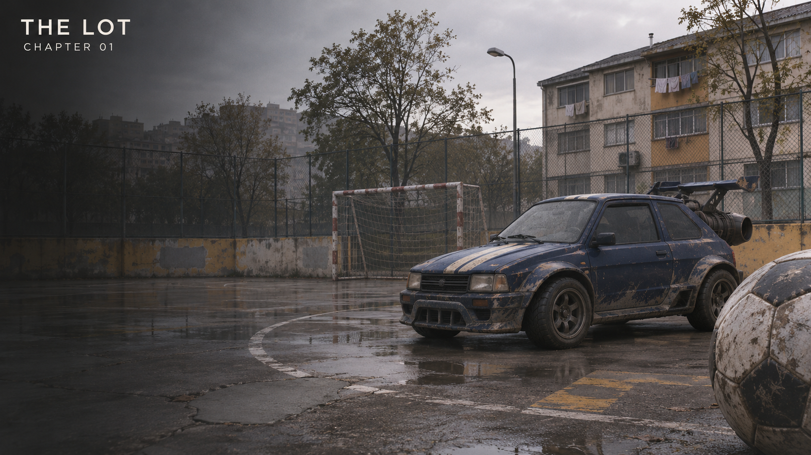
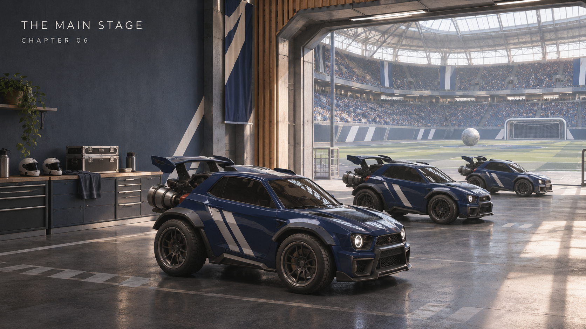
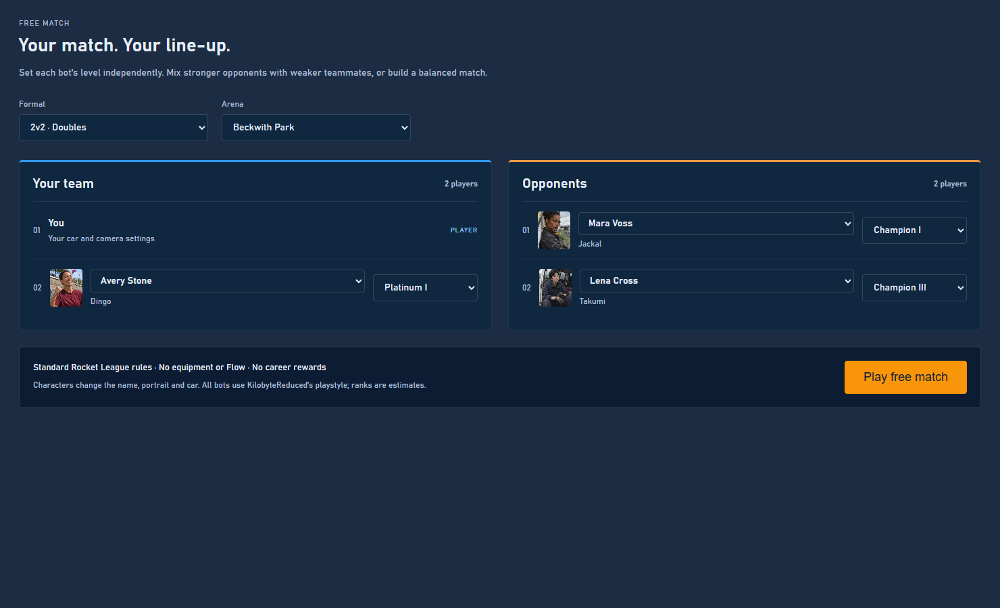

# RLBotGUI

This branch explores a playable career and custom free matches for RLBot v5. The original RLBot menus are kept intact; the Story Mode systems are experimental.

## Story Mode

From local games to the main stage: 24 fixtures, seven chapters, recruitment, saved line-ups, changing arenas and BO3/BO5 finals.

<p align="center">
  
  
</p>

*Temporary campaign concept artwork.*

## Free match

Build a 1v1, 2v2 or 3v3 and choose each bot's character and estimated rank independently. Portraits and cars follow the chosen character. Standard Rocket League rules, without career rewards or equipment.



## Meet the club

Named drivers keep their portraits and assigned cars across matches. Their personalities are currently visual and narrative; they do not imply independently trained bot behavior.

<p align="center">
  
  
  
</p>

Equipment and Flow State are unfinished experiments, with known bugs and provisional balance. See [STORY_MODE.md](STORY_MODE.md) for setup, features and limitations, and [STORY_CARS.md](STORY_CARS.md) for the drivers' cars. Concept art and portraits are AI-generated placeholders.

## About RLBotGUI

The official GUI for [RLBot](https://rlbot.org) v5. The RLBot GUI features:

- Easy match launching: drag-&-drop bots and human onto teams and press start.
- All match settings and mutators configurable with presets of official Rocket League game modes.
- Automatic download of verified bots from https://github.com/RLBot/botpack.
- Loadout editor to easily design your bot's loadout.
- A state-setting sandbox where you can drag-&-drop cars on the field, replay scenarios, run commands, and toggle rendering.

To use the RLBot GUI as a player or bot developer, please download the installer at https://rlbot.org/.

## Development

The RLBot GUI is built with:

* [Go](https://golang.org)
* [Wails](https://v3alpha.wails.io) (v3 alpha).
* [Svelte](https://svelte.dev)

This project is built using a [justfile](https://github.com/casey/just). Run `just build` to build, `just dev` to run in dev mode,
`just lint` to lint and `just format` to format. Remember to
[install dependencies](#Installing-build-dependencies) first.

### Update item data

Use BakkesMod to update the item list:

1. Install and run BakkesMod.
2. Start Rocket League.
3. Press `F6` to open the BakkesMod console.
4. Enter `dumpitems`.
5. Copy the generated `items.csv` from the Rocket League `Win64` directory to
   `frontend/src/assets/items.csv`.
6. Convert the file to UTF-8:

```bash
uv run scripts/reencode_items_csv.py
```

The script converts the Windows-1252 file to UTF-8 in place.

### Installing build dependencies

1. Install the [wails v3-alpha cli](https://v3alpha.wails.io/getting-started/installation/)
2. Install [node](https://nodejs.org/en) and [pnpm](https://pnpm.io/installation)
3. Run `cd frontend` and then `pnpm i` (you probably want to `cd ../` after)

### Linux runtime dependencies

* Either [zenity, matedialog or qarma](https://github.com/ncruces/zenity?tab=readme-ov-file#benefits-of-the-go-package)

### Deployment

- Make sure your local `master` branch is up-to-date.
- Run `just build windows` and `just build linux`.
- Create a new GitHub release with an appropriate name and tag
- Attach `bin/rlbotgui.exe` and `bin/rlbotgui` binaries
- Mark release as latest and click release!
